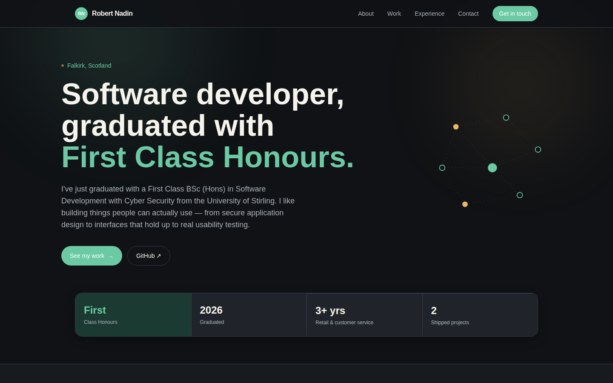

# Personal Portfolio Website


[](https://github.com/tyler-bravin/Robert-Nadin-Portfolio/blob/main/LICENSE)

A personal portfolio website built with **React.js** and **Tailwind CSS**, designed around a dark, editorial aesthetic — a two-tone green/gold accent system, Space Grotesk display type, and quiet, deliberate motion throughout. It's fully modular, with content (projects, experience, contact details) kept separate from presentation.

<br>


---

### ✨ Key Features

* **Cursor-Tracked Spotlight Cards**: Project cards follow the mouse with a soft radial highlight on hover.
* **Animated Stat Counters**: Key stats count up from zero the moment they scroll into view.
* **Scroll-Reveal Animations**: Sections fade and lift into place as you scroll, powered by `IntersectionObserver`.
* **Scroll Progress Indicator**: A slim gradient bar under the nav tracks how far down the page you are.
* **Ambient Background Glow**: Soft, slowly drifting gradient blobs behind the hero and contact sections for depth.
* **Film Grain Texture**: A subtle noise overlay across the whole page for a less flat, more premium feel.
* **Fully Responsive**: Tuned layouts across mobile, tablet, laptop, and large desktop monitors.
* **Modular Content**: Projects and experience data live in `src/data/`, separate from the components that render them — easy to update without touching layout code.
* **Accessible Motion**: All animation respects `prefers-reduced-motion`.

---

### 💻 Technologies Used

* **Frontend**: React.js, HTML5, CSS3, JavaScript
* **Build Tooling**: Vite
* **Styling**: Tailwind CSS, CSS Custom Properties
* **Animation**: Native CSS keyframes + `IntersectionObserver` (no external animation library)
* **Fonts**: Space Grotesk (display), Inter (body) via Google Fonts

---

### 🛠️ Installation & Setup

This repo lives under [tyler-bravin](https://github.com/tyler-bravin) — if you're Robert (or anyone else) wanting your own editable copy, **fork it first**, then clone your fork.

1.  **Fork the repository** using the "Fork" button on GitHub, then clone your fork:
    ```bash
    git clone https://github.com/<your-username>/Robert-Nadin-Portfolio.git
    cd Robert-Nadin-Portfolio
    ```
2.  **Install dependencies:**
    ```bash
    npm install
    ```
3.  **Start the development server:**
    ```bash
    npm run dev
    ```
    The application will now be running on `http://localhost:5173`.
4.  **Build for production:**
    ```bash
    npm run build
    ```
    The optimised output is written to `dist/`, and `npm run preview` serves it locally.

### 📁 Editing Content

No API keys or environment variables are needed. To update the site's content:

* **Projects & experience** — edit `src/data/projects.js` and `src/data/experience.js`.
* **Colours** — edit the palette in `src/theme.js`.
* **Copy** (hero text, stats, contact details) — edit the relevant component in `src/components/`.

### 🖼️ Icons & Social Preview

`public/` includes a full favicon set (standard + Apple touch icon + Android/PWA icons + maskable icon), a `site.webmanifest`, and an Open Graph / Twitter card image (`og-image.png`) — all generated from the site's own monogram and colour palette.

Once this is deployed to its real domain, update the placeholder URLs in `index.html` (`og:url`, `og:image`, `twitter:image` — currently `https://robertnadin.dev`) to match, otherwise link previews on social platforms and messaging apps won't resolve correctly.

### 📜 License

This project is licensed under the MIT License. See the `LICENSE` file for details.

### 🙌 Credits

Built by [Tyler Bravin](https://github.com/tyler-bravin) for [Robert Nadin](https://github.com/RobertNadin).
